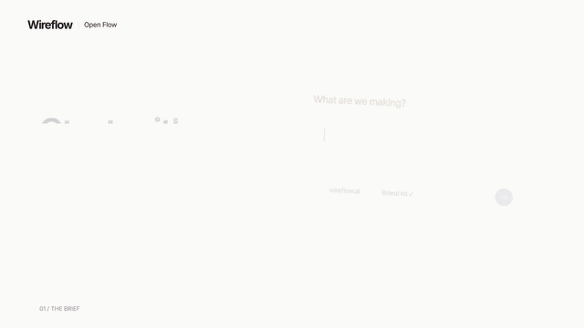

# Open Flow

Make an 18 second launch film for your product from 8 clips and a headline.
Open source, rendered in the cloud.

[](https://cdn.wireflow.ai/videos/remotion/22491/wo4mecwh84.mp4)

This film came out of the command below with no options. [Watch it with sound](https://cdn.wireflow.ai/videos/remotion/22491/wo4mecwh84.mp4) (1920x1080, 18 seconds).

[](./LICENSE)

## Make yours in 3 steps

You need Node 20 or newer. Nothing to install.

**1. Get a free API key.** Sign up at Wireflow and make a key on the
[API keys page](https://www.wireflow.ai/settings?tab=api-keys&section=api-keys&utm_source=github&utm_medium=readme&utm_campaign=open-flow).
Tick `workflows:write` and `workflows:execute` (read access is on by default).

**2. Get the code.**

```bash
git clone https://github.com/wireflowINC/wireflow-skill
cd wireflow-skill
export WIREFLOW_API_KEY="wf_live_..."
```

**3. Render your film.**

```bash
npm run film -- --brand "Acme" --headline "Launch day. Every version." --cta "acme.com" --clips ./my-clips
```

In 2 to 4 minutes it prints a link to your MP4 and a link to the board it
made in your Wireflow account. The render costs 0 credits. Run `npm run film`
with no options first if you want to see the demo film come out.

## Swap the clips, headline and CTA

| Option | What it changes | Limit |
| --- | --- | --- |
| `--clips ./my-clips` | The video clips. A folder, or a comma list of files or links. | 8 clips |
| `--headline "..."` | The closing line over the moving cards. | 45 characters |
| `--brand "..."` | The big name on the end card. | 24 characters |
| `--cta "..."` | The button on the end card, like your site. | 30 characters |
| `--music song.mp3` | The soundtrack. Default is the Open Flow score. | mp3, wav, m4a |
| `--no-render` | Build the board but do not render. | |

Tips for clips:

- Name them in the order you want (`1.mp4`, `2.mp4`, ...). Clip 1 is on
  screen the longest. Clip 4 is the "your product" shot.
- Give fewer than 8 and they repeat to fill the slots.
- Tall phone clips look best, since the cards are tall. Wide clips get cropped.
- 3 to 15 seconds each is plenty. mp4, mov, m4v or webm, up to 100MB each.

Want to change one thing later? Open the board link, edit a Text node or drop
a new clip into an Import node, then press Run on the film node.

## How it works

1. [`WireflowFilm.tsx`](examples/open-flow-launch/WireflowFilm.tsx) is the film, a Remotion composition. Every clip and line of text is a prop.
2. Wireflow hosts a built copy of it as a Block, with each prop as an input port.
3. [`film.mjs`](examples/open-flow-launch/film.mjs) uploads your clips and makes a board: one node per clip, a music node and three text nodes, all wired into one Video Editor node.
4. It runs that node, and Wireflow renders the film in the cloud at 1920x1080, 30 fps, with sound.
5. You get the MP4, plus a board you can edit and run again.

More detail, and how to render on your own machine with Remotion, is in
[examples/open-flow-launch](examples/open-flow-launch/README.md).

## Use it from Claude Code

This repo is also the Wireflow skill for Claude. Install it once, then ask
Claude to build and run Wireflow workflows (image, video, audio) with your
API key, in any project.

```bash
git clone https://github.com/wireflowINC/wireflow-skill ~/.claude/skills/wireflow
```

Claude Code picks up any skill in `~/.claude/skills/`. New sessions see the
`wireflow` skill and use it when you say things like "wireflow", "build a
workflow", "run a workflow" or "remotion template". Full docs:
<https://wireflow.ai/skill>

Setup is the same API key as above, with the scopes you need
(`workflows:read`, `workflows:write`, `workflows:execute`). Put
`export WIREFLOW_API_KEY="wf_live_..."` in your shell profile and restart
the terminal.

Key order is the `WIREFLOW_API_KEY` env var, then a `--key <key>` flag, then a
`.env` in the current folder. A key read from `./.env` prints a one line
notice, so a repo's own `.env` can't quietly swap accounts. For a one-off
call: `bash scripts/wf.sh --key wf_live_... <verb> ...`.

Things to ask Claude:

> Build me a Wireflow workflow that takes a product name, has Claude write
> a viral TikTok hook, then makes a 9:16 product photo with Nano Banana.

> Run my Wireflow workflow `<id>` with the prompt "a cow in a neon field"
> and download the result.

> Make me an Open Flow launch film with these clips and the headline "Ship it."

What's in the bundle:

- `SKILL.md`: the skill itself, the core loop and trigger words
- `references/api.md`: the REST API with curl examples
- `references/workflow-schema.md`: node and edge JSON, common patterns, rules that bite
- `references/remotion-templates.md`: how to set up Remotion nodes from template specs
- `references/open-flow.md`: creative direction for launch films
- `scripts/wf.sh`: one command for common API calls (templates, create, run,
  poll, list, duplicate, patch-node, credits). `patch-node <id> <nodeId> '{"config":{"prompt":"new text"}}'`
  changes one node without sending the whole graph. Its `check` step (also
  run inside `create`, `update` and `organize`) lints the workflow through the
  server's `/workflows/lint` endpoint, so you never need the Wireflow code.
- `examples/`: working workflow JSON (text to image, text to video, image and
  audio to a Remotion render) and the Open Flow film

What the skill can't do:

- **Add new Remotion compositions to Wireflow.** The skill sets up existing
  compositions and blocks through their ports and props. Uploading new block
  code is open to the Wireflow team only for now.
- **Replace the visual editor.** Big workflows are still easier to sketch in
  the editor first, then run through the skill.
- **Skip credit costs.** Paid nodes (Kling, Veo and other generators) use
  credits. The skill checks your balance before it starts a paid video job.
  The Open Flow film uses no paid nodes.

## License

MIT, see [LICENSE](./LICENSE). The two fonts in
`examples/open-flow-launch/fonts` are under the SIL Open Font License (notices
in that folder). The demo clips are Wireflow marketing footage and are not
covered by the MIT license; use your own clips for your film.

## Want us to make your launch video?

We make launch films and ads for startups.
[Get a free media plan](https://www.wireflow.ai/startups?utm_source=github&utm_medium=readme&utm_campaign=open-flow).
